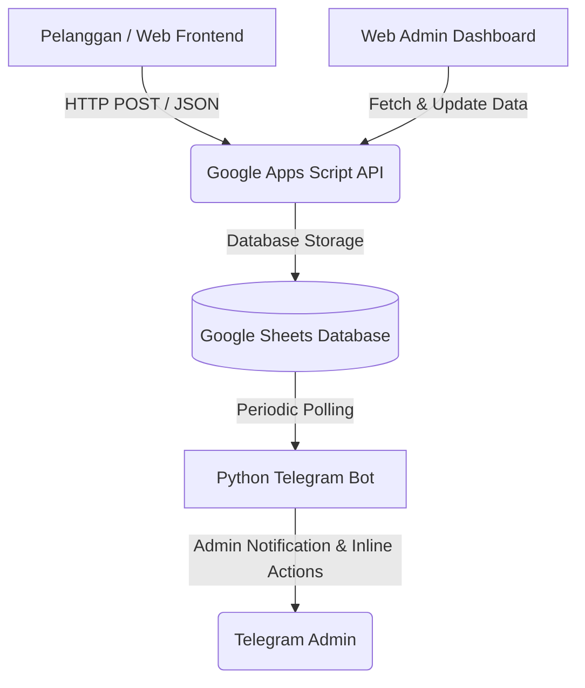

# 💧 Air Mata Duyung
### Automated Hybrid Order Management System

> Sistem manajemen pesanan hibrida otomatis untuk depot air minum yang mengintegrasikan Telegram Mini App, Google Sheets sebagai database *real-time*, Bot Telegram untuk notifikasi & kontrol operasional, serta Web Admin Dashboard berbasis Telegram WebApp.

---

## 🚀 Overview & Architecture

Proyek ini dibangun untuk mendigitalisasi operasional depot air secara *end-to-end* tanpa memerlukan server backend berbiaya tinggi (*serverless architecture*).



---

## ✨ Key Features

1. **Telegram Mini App & Web Catalog**  
   Katalog produk interaktif yang mendeteksi profil pengguna secara otomatis dengan fitur validasi stok *real-time*.

2. **Smart Multi-Product Parser**  
   Mendukung pembelian multi-produk dengan pemisah khusus (titik koma `;`) untuk menghindari konflik *parsing* pada nama produk yang mengandung koma desimal (contoh: *Galon Cleo 12,8L*).

3. **Automated Stock Deduction**  
   Stok produk di Google Sheets berkurang secara otomatis dan akurat hanya ketika status pesanan diubah menjadi **"Dikirim"**.

4. **Interactive Telegram Bot & Admin Dashboard**  
   * Notifikasi instan ke admin saat ada pesanan masuk.
   * Tombol interaktif (*Inline Keyboards*) untuk mengubah status pesanan langsung dari chat Telegram.
   * **Web Admin Dashboard** terproteksi PIN yang dapat diakses via browser atau langsung di dalam Telegram Mini App untuk memantau omzet, statistik transaksi, dan sisa stok.

---

## 🛠️ Tech Stack

* **Frontend:** HTML5, CSS3 (Modern Flexbox/Grid, Responsive Design), JavaScript (Vanilla JS).
* **Backend & API:** Google Apps Script (GAS) Serverless Web App.
* **Database:** Google Sheets.
* **Bot Engine:** Python (`python-telegram-bot`, `asyncio`, `requests`).
* **Hosting:** GitHub Pages.

---

## 📂 Project Structure

```text
.
├── index.html          # Katalog Web / Telegram Mini App Frontend
├── admin.html          # Web Admin Dashboard (Omzet, Stok, & Riwayat)
├── bot.py              # Python Telegram Bot & Background Polling Worker
└── Code.gs             # Google Apps Script (Backend API & Business Logic)
```

---

## ⚙️ How It Works

1. **Pemesanan:** Pelanggan memilih produk melalui Web/Mini App, mengisi alamat dan kontak, lalu data dikirim via POST ke Google Apps Script.

2. **Notifikasi:** Bot Python memonitor database secara periodik dan mengirimkan notifikasi instan ber-tombol interaktif ke Admin Telegram.

3. **Eksekusi:** Admin menekan tombol **Dikirim** di Telegram atau mengelolanya via Web Admin Dashboard, yang secara otomatis memicu skrip backend untuk mengurangi stok produk di database.
